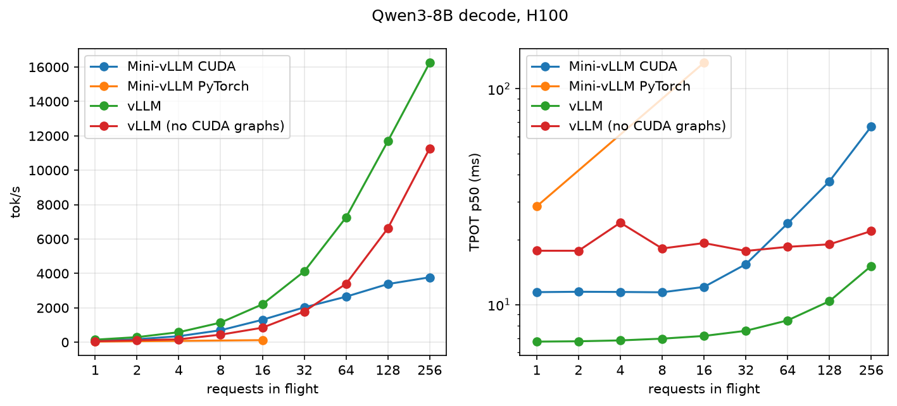

# Baseline: Qwen3-8B, one H100

Engine `028765a`, measured at `a20dd43`. H100 80GB HBM3 (SXM), driver 610.57. Mini-vLLM: torch 2.14.1+cu130,
kernels built for sm_90a. vLLM 0.31.0. Tests: 320/320 pass on the H100.

## Setup

| engine | |
|---|---|
| Mini-vLLM CUDA | custom kernels, no CUDA graphs |
| Mini-vLLM PyTorch | pure-PyTorch oracle; 1 and 16 in flight only |
| vLLM | CUDA graphs + `torch.compile` |
| vLLM (no CUDA graphs) | `enforce_eager=True`: no graphs, no `torch.compile`; runs like Mini-vLLM today |

| workload | in / out tokens | load |
|---|---|---|
| decode-heavy | 128 / 512 | 1–256 in flight |
| prefill-heavy | 2,048 / 16 | 8 in flight |
| mixed | ~512 / ~128, lognormal | Poisson, 1–16 req/s |
| shared-prefix | 1,024 shared + 64 / 64 | 8 in flight |

All engines: 12,288 KV blocks × 16 tokens, ≤256 sequences, 4,096 batched tokens, bf16, greedy, prefix caching on.
MBU = (15.1 GB weights + 144 KiB × context tokens) / step time / 3.35 TB/s.

```bash
uv run --group cloud modal run -m cloud.app::sweep --suite full --engines mini-cuda,mini-torch,vllm,vllm-no-graphs --tag baseline
```



## Findings

| metric | Mini-vLLM CUDA | vLLM | vLLM (no CUDA graphs) | cause → fix |
|---|---|---|---|---|
| decode-heavy, 1 in flight: TPOT (ms) | 11.4 | 6.7 | 17.8 | GPU 44% busy at 16 in flight, 884 launches/step → CUDA graphs (Phase 8) |
| decode-heavy, 256 in flight: tok/s | 3.8k | 16.3k | 11.3k | paged attention 29 of 38 GPU ms; KV read once per head in each GQA group → Triton kernel (Phase 7), split-K (Phase 9) |
| prefill-heavy: TTFT p99 (ms) | 1,151 | 395 | 407 | prefill runs one sequence at a time from Python → Phases 6, 7 |
| prefill-heavy: TPOT p50 (ms) | 67 | 16 | 26 | decodes wait on those prefill steps |
| shared-prefix: TTFT p50 (ms) | 120 | 30 | 61 | prefix cache filled only when a request frees |

GEMMs reach 72% of peak bandwidth (15.1 GB in 6.3 ms); the gap is overhead around them.
Mini-vLLM PyTorch: TPOT 29 ms at 1 in flight, 132 ms at 16; ~16k kernels/step.

## Run-to-run variance

Same traces, two containers:

| engine | tok/s change |
|---|---|
| vLLM | ≤1.5% |
| Mini-vLLM CUDA | ≤1% when GPU-bound (128+ in flight, prefill-heavy, shared-prefix); −5% to +15% at 1–64 in flight |
| vLLM (no CUDA graphs) | −3% to −35% |
| Mini-vLLM PyTorch | +62% |

Python-bound steps track the host CPU. Compare them with a same-container A/B or the median of 3 runs. Runs now
record the CPU model.

## Full tables

From [baseline.json](baseline.json).

### Environment

| engine | GPU | CPU | driver | torch | CUDA | load (s) | KV blocks |
|---|---|---|---|---|---|---|---|
| Mini-vLLM CUDA | NVIDIA H100 80GB HBM3 | - | 610.57.04 | 2.14.1+cu130 | 13.0 | 10.2 | 12288 |
| Mini-vLLM PyTorch | NVIDIA H100 80GB HBM3 | - | 610.57.04 | 2.14.1+cu130 | 13.0 | 8.4 | 12288 |
| vLLM | NVIDIA H100 80GB HBM3 | - | 610.57.04 | 2.13.0+cu130, vLLM 0.31.0 | 13.0 | 112.2 | 12288 |
| vLLM (no CUDA graphs) | NVIDIA H100 80GB HBM3 | - | 610.57.04 | 2.13.0+cu130, vLLM 0.31.0 | 13.0 | 45.9 | 12288 |

### decode-heavy (128 in, 512 out)

**tok/s**

| load | Mini-vLLM CUDA | Mini-vLLM PyTorch | vLLM | vLLM (no CUDA graphs) |
|---|---|---|---|---|
| 1 in flight | 87 | 35 | 148 | 56 |
| 2 in flight | 174 | - | 295 | 112 |
| 4 in flight | 351 | - | 583 | 169 |
| 8 in flight | 695 | - | 1,140 | 439 |
| 16 in flight | 1,304 | 121 | 2,205 | 844 |
| 32 in flight | 2,027 | - | 4,117 | 1,788 |
| 64 in flight | 2,648 | - | 7,255 | 3,395 |
| 128 in flight | 3,383 | - | 11,691 | 6,625 |
| 256 in flight | 3,775 | - | 16,251 | 11,270 |

**TTFT p50 (ms)**

| load | Mini-vLLM CUDA | Mini-vLLM PyTorch | vLLM | vLLM (no CUDA graphs) |
|---|---|---|---|---|
| 1 in flight | 15.0 | 28.6 | 11.7 | 39.1 |
| 2 in flight | 27.6 | - | 13.7 | 49.7 |
| 4 in flight | 37.5 | - | 22.0 | 73.7 |
| 8 in flight | 64.9 | - | 39.1 | 59.1 |
| 16 in flight | 117.5 | 155.0 | 57.9 | 78.6 |
| 32 in flight | 231.0 | - | 126.6 | 134.0 |
| 64 in flight | 264.2 | - | 192.6 | 224.4 |
| 128 in flight | 264.2 | - | 284.8 | 282.1 |
| 256 in flight | 468.5 | - | 308.5 | 304.8 |

**TTFT p99 (ms)**

| load | Mini-vLLM CUDA | Mini-vLLM PyTorch | vLLM | vLLM (no CUDA graphs) |
|---|---|---|---|---|
| 1 in flight | 21.9 | 35.1 | 12.4 | 46.8 |
| 2 in flight | 27.6 | - | 13.7 | 67.7 |
| 4 in flight | 37.5 | - | 24.6 | 89.0 |
| 8 in flight | 64.9 | - | 42.1 | 78.6 |
| 16 in flight | 117.5 | 155.0 | 61.2 | 110.1 |
| 32 in flight | 231.0 | - | 131.5 | 151.0 |
| 64 in flight | 501.2 | - | 210.7 | 261.1 |
| 128 in flight | 1,005.4 | - | 411.3 | 430.8 |
| 256 in flight | 2,058.8 | - | 833.2 | 883.2 |

**TPOT p50 (ms)**

| load | Mini-vLLM CUDA | Mini-vLLM PyTorch | vLLM | vLLM (no CUDA graphs) |
|---|---|---|---|---|
| 1 in flight | 11.42 | 28.54 | 6.74 | 17.77 |
| 2 in flight | 11.47 | - | 6.76 | 17.77 |
| 4 in flight | 11.45 | - | 6.83 | 23.97 |
| 8 in flight | 11.41 | - | 6.95 | 18.20 |
| 16 in flight | 12.08 | 132.09 | 7.16 | 19.29 |
| 32 in flight | 15.39 | - | 7.56 | 17.73 |
| 64 in flight | 23.77 | - | 8.45 | 18.52 |
| 128 in flight | 37.26 | - | 10.37 | 19.03 |
| 256 in flight | 66.87 | - | 15.10 | 21.92 |

**ITL p99 (ms)**

| load | Mini-vLLM CUDA | Mini-vLLM PyTorch | vLLM | vLLM (no CUDA graphs) |
|---|---|---|---|---|
| 1 in flight | 11.57 | 29.58 | 7.09 | 20.71 |
| 2 in flight | 11.59 | - | 7.12 | 23.05 |
| 4 in flight | 11.59 | - | 7.31 | 46.49 |
| 8 in flight | 11.52 | - | 7.28 | 21.31 |
| 16 in flight | 13.25 | 136.83 | 7.63 | 22.46 |
| 32 in flight | 18.35 | - | 8.22 | 19.95 |
| 64 in flight | 35.14 | - | 9.50 | 23.05 |
| 128 in flight | 47.38 | - | 23.49 | 21.77 |
| 256 in flight | 236.86 | - | 34.27 | 29.94 |

**MBU % (from ITL)**

| load | Mini-vLLM CUDA | Mini-vLLM PyTorch | vLLM | vLLM (no CUDA graphs) |
|---|---|---|---|---|
| 1 in flight | 39.7 | 16.0 | 67.3 | 25.1 |
| 2 in flight | 39.7 | - | 67.3 | 25.4 |
| 4 in flight | 40.7 | - | 67.2 | 20.1 |
| 8 in flight | 40.8 | - | 66.8 | 25.4 |
| 16 in flight | 40.3 | 3.6 | 67.0 | 25.4 |
| 32 in flight | 33.0 | - | 66.9 | 27.7 |
| 64 in flight | 24.1 | - | 66.6 | 30.2 |
| 128 in flight | 18.4 | - | 67.5 | 36.0 |
| 256 in flight | 13.6 | - | 62.0 | 40.8 |

**MBU % (forward)**

| load | Mini-vLLM CUDA | Mini-vLLM PyTorch | vLLM | vLLM (no CUDA graphs) |
|---|---|---|---|---|
| 1 in flight | 41.2 | 16.2 | - | - |
| 2 in flight | 41.3 | - | - | - |
| 4 in flight | 42.3 | - | - | - |
| 8 in flight | 42.9 | - | - | - |
| 16 in flight | 42.4 | 3.7 | - | - |
| 32 in flight | 34.9 | - | - | - |
| 64 in flight | 25.6 | - | - | - |
| 128 in flight | 19.7 | - | - | - |
| 256 in flight | 14.6 | - | - | - |

**MBU % (step)**

| load | Mini-vLLM CUDA | Mini-vLLM PyTorch | vLLM | vLLM (no CUDA graphs) |
|---|---|---|---|---|
| 1 in flight | 39.8 | 16.0 | - | - |
| 2 in flight | 39.8 | - | - | - |
| 4 in flight | 40.6 | - | - | - |
| 8 in flight | 40.9 | - | - | - |
| 16 in flight | 40.3 | 3.6 | - | - |
| 32 in flight | 33.1 | - | - | - |
| 64 in flight | 24.3 | - | - | - |
| 128 in flight | 18.6 | - | - | - |
| 256 in flight | 13.8 | - | - | - |

### prefill-heavy (2048 in, 16 out)

**tok/s**

| load | Mini-vLLM CUDA | Mini-vLLM PyTorch | vLLM | vLLM (no CUDA graphs) |
|---|---|---|---|---|
| 8 in flight | 96 | - | 259 | 202 |

**TTFT p50 (ms)**

| load | Mini-vLLM CUDA | Mini-vLLM PyTorch | vLLM | vLLM (no CUDA graphs) |
|---|---|---|---|---|
| 8 in flight | 275.2 | - | 242.8 | 248.9 |

**TTFT p99 (ms)**

| load | Mini-vLLM CUDA | Mini-vLLM PyTorch | vLLM | vLLM (no CUDA graphs) |
|---|---|---|---|---|
| 8 in flight | 1,150.8 | - | 394.6 | 407.0 |

**TPOT p50 (ms)**

| load | Mini-vLLM CUDA | Mini-vLLM PyTorch | vLLM | vLLM (no CUDA graphs) |
|---|---|---|---|---|
| 8 in flight | 67.34 | - | 16.40 | 26.34 |

**ITL p99 (ms)**

| load | Mini-vLLM CUDA | Mini-vLLM PyTorch | vLLM | vLLM (no CUDA graphs) |
|---|---|---|---|---|
| 8 in flight | 275.18 | - | 97.95 | 118.37 |

### mixed (~512 in, ~128 out, lognormal)

**tok/s**

| load | Mini-vLLM CUDA | Mini-vLLM PyTorch | vLLM | vLLM (no CUDA graphs) |
|---|---|---|---|---|
| 1 req/s | 110 | - | 113 | 106 |
| 2 req/s | 295 | - | 322 | 267 |
| 4 req/s | 509 | - | 548 | 475 |
| 8 req/s | 905 | - | 1,048 | 902 |
| 16 req/s | 1,139 | - | 1,957 | 1,403 |

**TTFT p50 (ms)**

| load | Mini-vLLM CUDA | Mini-vLLM PyTorch | vLLM | vLLM (no CUDA graphs) |
|---|---|---|---|---|
| 1 req/s | 42.4 | - | 29.6 | 63.4 |
| 2 req/s | 46.9 | - | 32.7 | 64.3 |
| 4 req/s | 45.9 | - | 32.9 | 64.3 |
| 8 req/s | 59.7 | - | 35.4 | 63.2 |
| 16 req/s | 157.2 | - | 42.1 | 64.2 |

**TTFT p99 (ms)**

| load | Mini-vLLM CUDA | Mini-vLLM PyTorch | vLLM | vLLM (no CUDA graphs) |
|---|---|---|---|---|
| 1 req/s | 158.3 | - | 43.3 | 78.4 |
| 2 req/s | 107.9 | - | 60.9 | 79.8 |
| 4 req/s | 203.6 | - | 55.9 | 83.0 |
| 8 req/s | 160.7 | - | 68.0 | 82.0 |
| 16 req/s | 412.8 | - | 157.0 | 119.1 |

**TPOT p50 (ms)**

| load | Mini-vLLM CUDA | Mini-vLLM PyTorch | vLLM | vLLM (no CUDA graphs) |
|---|---|---|---|---|
| 1 req/s | 11.71 | - | 6.80 | 17.56 |
| 2 req/s | 12.28 | - | 6.98 | 17.47 |
| 4 req/s | 13.70 | - | 7.20 | 17.82 |
| 8 req/s | 21.63 | - | 7.84 | 17.51 |
| 16 req/s | 51.96 | - | 9.73 | 18.11 |

**ITL p99 (ms)**

| load | Mini-vLLM CUDA | Mini-vLLM PyTorch | vLLM | vLLM (no CUDA graphs) |
|---|---|---|---|---|
| 1 req/s | 14.01 | - | 7.50 | 19.70 |
| 2 req/s | 39.81 | - | 10.28 | 19.72 |
| 4 req/s | 49.38 | - | 20.64 | 21.79 |
| 8 req/s | 88.66 | - | 22.55 | 23.02 |
| 16 req/s | 203.66 | - | 27.91 | 37.31 |

### shared-prefix (1024 shared + 64 in, 64 out)

**tok/s**

| load | Mini-vLLM CUDA | Mini-vLLM PyTorch | vLLM | vLLM (no CUDA graphs) |
|---|---|---|---|---|
| 8 in flight | 488 | - | 1,072 | 442 |

**TTFT p50 (ms)**

| load | Mini-vLLM CUDA | Mini-vLLM PyTorch | vLLM | vLLM (no CUDA graphs) |
|---|---|---|---|---|
| 8 in flight | 120.0 | - | 30.2 | 60.6 |

**TTFT p99 (ms)**

| load | Mini-vLLM CUDA | Mini-vLLM PyTorch | vLLM | vLLM (no CUDA graphs) |
|---|---|---|---|---|
| 8 in flight | 490.7 | - | 45.7 | 64.4 |

**TPOT p50 (ms)**

| load | Mini-vLLM CUDA | Mini-vLLM PyTorch | vLLM | vLLM (no CUDA graphs) |
|---|---|---|---|---|
| 8 in flight | 13.99 | - | 7.06 | 17.39 |

**ITL p99 (ms)**

| load | Mini-vLLM CUDA | Mini-vLLM PyTorch | vLLM | vLLM (no CUDA graphs) |
|---|---|---|---|---|
| 8 in flight | 93.44 | - | 7.46 | 20.65 |

### Profile: Mini-vLLM CUDA, decode-16-in-flight

Step 20.3 ms, GPU 8.9 ms (44% busy), 884 kernels.

| GPU category | ms/step |
|---|---|
| gemm | 6.258 |
| attention | 1.877 |
| norm | 0.309 |
| rope | 0.127 |
| elementwise | 0.118 |
| kv_write | 0.095 |
| activation | 0.080 |
| copy | 0.022 |
| sampling | 0.011 |

| host span | ms/step |
|---|---|
| schedule | 0.075 |
| prepare | 0.314 |
| forward | 19.211 |
| sample | 0.504 |
| spec.verify | 0.014 |
| commit | 0.024 |

| kernel | category | ms/step | calls |
|---|---|---|---|
| `nvjet_sm90_tst_64x16_64x16_4x1_v_bz_TNT` | gemm | 2.666 | 72 |
| `void (anonymous namespace)::paged_attention_kernel<c10::BFloat16, c10::BFloat16>` | attention | 1.877 | 36 |
| `nvjet_sm90_tst_64x16_64x16_2x1_v_bz_splitK_TNT` | gemm | 1.369 | 36 |
| `nvjet_sm90_tst_128x16_64x11_4x1_v_bz_splitK_TNT` | gemm | 1.024 | 72 |
| `nvjet_sm90_tst_384x16_64x4_2x1_v_bz_TNT` | gemm | 0.441 | 1 |
| `nvjet_sm90_tst_64x16_64x16_4x1_v_bz_splitK_TNT` | gemm | 0.427 | 72 |
| `void cublasLt::splitKreduce_kernel<32, 16, int, float, __nv_bfloat16, float, __n` | gemm | 0.331 | 180 |
| `void (anonymous namespace)::rms_norm_kernel<c10::BFloat16, mini_vllm::Vector<c10` | norm | 0.309 | 145 |
| `void (anonymous namespace)::rope_kernel<c10::BFloat16>(c10::BFloat16 const*, int` | rope | 0.127 | 72 |
| `void at::native::vectorized_elementwise_kernel<8, at::native::CUDAFunctor_add<c1` | elementwise | 0.118 | 72 |

### Profile: Mini-vLLM CUDA, decode-256-in-flight

Step 42.4 ms, GPU 38.1 ms (90% busy), 704 kernels.

| GPU category | ms/step |
|---|---|
| attention | 29.131 |
| gemm | 7.499 |
| norm | 0.558 |
| rope | 0.231 |
| elementwise | 0.208 |
| activation | 0.205 |
| kv_write | 0.140 |
| copy | 0.074 |
| sampling | 0.056 |

| host span | ms/step |
|---|---|
| schedule | 0.990 |
| prepare | 1.172 |
| forward | 17.433 |
| sample | 22.175 |
| spec.verify | 0.023 |
| commit | 0.145 |

| kernel | category | ms/step | calls |
|---|---|---|---|
| `void (anonymous namespace)::paged_attention_kernel<c10::BFloat16, c10::BFloat16>` | attention | 29.131 | 36 |
| `nvjet_sm90_tst_128x64_64x8_1x2_h_bz_TNT` | gemm | 3.199 | 108 |
| `nvjet_sm90_tst_192x128_64x5_1x2_h_bz_coopB_TNT` | gemm | 3.063 | 72 |
| `nvjet_sm90_tst_64x32_64x16_1x2_h_bz_TNT` | gemm | 0.748 | 72 |
| `void (anonymous namespace)::rms_norm_kernel<c10::BFloat16, mini_vllm::Vector<c10` | norm | 0.558 | 145 |
| `nvjet_sm90_tst_256x128_64x4_1x2_h_bz_coopA_TNT` | gemm | 0.490 | 1 |
| `void (anonymous namespace)::rope_kernel<c10::BFloat16>(c10::BFloat16 const*, int` | rope | 0.231 | 72 |
| `void at::native::vectorized_elementwise_kernel<8, at::native::CUDAFunctor_add<c1` | elementwise | 0.208 | 72 |
| `void (anonymous namespace)::swiglu_kernel<c10::BFloat16, mini_vllm::Vector<c10::` | activation | 0.205 | 36 |
| `void (anonymous namespace)::paged_cache_update_kernel<c10::BFloat16>(int const*,` | kv_write | 0.140 | 72 |

### Profile: Mini-vLLM CUDA, mixed

Step 29.2 ms, GPU 19.3 ms (66% busy), 1,013 kernels.

| GPU category | ms/step |
|---|---|
| attention | 9.494 |
| gemm | 7.891 |
| copy | 0.627 |
| norm | 0.519 |
| rope | 0.224 |
| activation | 0.193 |
| elementwise | 0.185 |
| kv_write | 0.136 |
| sampling | 0.011 |

| host span | ms/step |
|---|---|
| schedule | 0.089 |
| prepare | 0.488 |
| forward | 27.701 |
| sample | 0.614 |
| spec.verify | 0.015 |
| commit | 0.078 |

| kernel | category | ms/step | calls |
|---|---|---|---|
| `(anonymous namespace)::flash_prefill_kernel(__nv_bfloat16 const*, __nv_bfloat16 ` | attention | 4.819 | 14.4 |
| `void (anonymous namespace)::paged_attention_kernel<c10::BFloat16, c10::BFloat16>` | attention | 4.675 | 36 |
| `nvjet_sm90_tst_64x16_64x16_4x1_v_bz_TNT` | gemm | 1.636 | 43.2 |
| `nvjet_sm90_tst_64x16_64x16_2x1_v_bz_splitK_TNT` | gemm | 0.821 | 21.6 |
| `nvjet_sm90_tst_192x176_64x4_1x2_h_bz_coopB_TNT` | gemm | 0.656 | 7.2 |
| `nvjet_sm90_tst_128x16_64x11_4x1_v_bz_splitK_TNT` | gemm | 0.609 | 43.2 |
| `nvjet_sm90_tst_192x144_64x5_1x2_h_bz_coopB_TNT` | gemm | 0.549 | 7.2 |
| `nvjet_sm90_tst_128x176_64x5_2x1_v_bz_TNT` | gemm | 0.534 | 10.8 |
| `void (anonymous namespace)::rms_norm_kernel<c10::BFloat16, mini_vllm::Vector<c10` | norm | 0.519 | 145 |
| `nvjet_sm90_tst_128x144_64x6_2x1_v_bz_TNT` | gemm | 0.451 | 10.8 |

### Profile: Mini-vLLM PyTorch, decode-16-in-flight

Step 271.3 ms, GPU 40.4 ms (15% busy), 15,975 kernels.

| GPU category | ms/step |
|---|---|
| copy | 17.222 |
| elementwise | 11.522 |
| gemm | 10.375 |
| other | 1.094 |
| kv_write | 0.205 |
| sampling | 0.011 |

| host span | ms/step |
|---|---|
| schedule | 0.064 |
| prepare | 0.251 |
| forward | 270.312 |
| sample | 0.461 |
| spec.verify | 0.011 |
| commit | 0.022 |

| kernel | category | ms/step | calls |
|---|---|---|---|
| `void at::native::elementwise_kernel<128, 2, at::native::gpu_kernel_impl_nocast<a` | copy | 5.389 | 1152 |
| `void at::native::unrolled_elementwise_kernel<at::native::direct_copy_kernel_cuda` | copy | 5.332 | 1945 |
| `nvjet_sm90_tst_64x16_64x16_4x1_v_bz_TNT` | gemm | 2.729 | 72 |
| `void at::native::vectorized_gather_kernel<16, long>(char*, char*, long*, int, lo` | copy | 2.318 | 1299 |
| `void gemvNSP_kernel<float, float, float, float, 1, 16, 4, 1024, false, cublasGem` | gemm | 2.096 | 576 |
| `void gemvNSP_kernel<float, float, float, float, 1, 32, 4, 1024, false, cublasGem` | gemm | 1.888 | 576 |
| `void at::native::elementwise_kernel<128, 2, at::native::gpu_kernel_impl_nocast<a` | elementwise | 1.849 | 1152 |
| `void at::native::reduce_kernel<512, 1, at::native::ReduceOp<float, at::native::f` | elementwise | 1.618 | 576 |
| `void at::native::reduce_kernel<512, 1, at::native::ReduceOp<float, at::native::f` | elementwise | 1.517 | 576 |
| `nvjet_sm90_tst_64x16_64x16_2x1_v_bz_splitK_TNT` | gemm | 1.375 | 36 |

### Profile: Mini-vLLM PyTorch, mixed

Step 260.2 ms, GPU 62.3 ms (24% busy), 15,903 kernels.

| GPU category | ms/step |
|---|---|
| copy | 30.160 |
| elementwise | 16.002 |
| gemm | 14.742 |
| other | 1.150 |
| kv_write | 0.232 |
| sampling | 0.011 |

| host span | ms/step |
|---|---|
| schedule | 0.081 |
| prepare | 0.457 |
| forward | 258.881 |
| sample | 0.498 |
| spec.verify | 0.012 |
| commit | 0.080 |

| kernel | category | ms/step | calls |
|---|---|---|---|
| `void at::native::elementwise_kernel<128, 2, at::native::gpu_kernel_impl_nocast<a` | copy | 15.817 | 1152 |
| `void at::native::unrolled_elementwise_kernel<at::native::direct_copy_kernel_cuda` | copy | 6.555 | 1945 |
| `void at::native::vectorized_gather_kernel<16, long>(char*, char*, long*, int, lo` | copy | 2.973 | 1299 |
| `void at::native::elementwise_kernel<128, 2, at::native::gpu_kernel_impl_nocast<a` | elementwise | 2.659 | 1152 |
| `void at::native::reduce_kernel<512, 1, at::native::ReduceOp<float, at::native::f` | elementwise | 2.286 | 576 |
| `void at::native::reduce_kernel<512, 1, at::native::ReduceOp<float, at::native::f` | elementwise | 2.232 | 576 |
| `std::enable_if<!(false), void>::type internal::gemvx::kernel<int, int, float, fl` | gemm | 1.834 | 342 |
| `nvjet_sm90_tst_64x16_64x16_4x1_v_bz_TNT` | gemm | 1.681 | 43.2 |
| `std::enable_if<!(false), void>::type internal::gemvx::kernel<int, int, float, fl` | gemm | 1.604 | 457.2 |
| `sm80_xmma_gemm_f32f32_f32f32_f32_nn_n_tilesize64x64x8_stage3_warpsize1x4x1_ffma_` | gemm | 1.532 | 18 |
