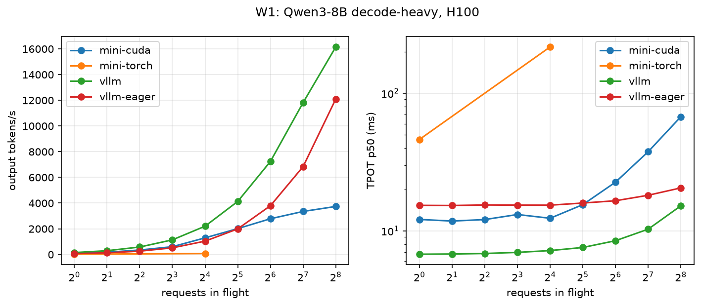

# Baseline: Qwen3-8B on one H100, before the refactor

Every later phase of the refactor is measured against these numbers. The engine code is that of
`028765a`. Phase 0 added only instrumentation and the harness: the sweep ran at `02a2a97` and the
profiles at `3c01f0f`.

- **Hardware:** Modal `gpu="H100!"`, an NVIDIA H100 80GB HBM3 (SXM, 3.35 TB/s), driver 610.57.04.
- **Software:** Mini-vLLM on torch 2.14.1+cu130 with the CUDA extension built for sm_90a; vLLM 0.31.0
  on torch 2.13.0+cu130.
- **Correctness:** the full test suite passes on the H100, 320 passed with none skipped, including
  every CUDA-kernel and real-Qwen3 test.

## Setup

- **Same limits for both engines:** 12,288 KV blocks of 16 tokens (196k tokens; vLLM's
  `num_gpu_blocks_override`), at most 256 sequences, 4,096 batched tokens, `max_model_len` 4,096,
  prefix caching on, bf16.
- **Requests:** greedy, EOS ignored, prompts of random token ids.
- **One driver for both:** each engine is stepped from the same in-process loop
  (`cloud/workload.py`), and a token is timestamped when the step that produced it returns.
  - TTFT counts from arrival, so queueing is included.
  - TPOT is (last token − first token) / (n − 1) per request.
- **vLLM:** run with CUDA graphs and `torch.compile` (`vllm`) and without them (`vllm-eager`). Its
  FlashInfer sampler is off because the image has no nvcc. Greedy requests never reach that sampler.
- **Decode MBU:** (15.1 GB of weights + 144 KiB × context tokens) / step time / 3.35 TB/s.
  - The estimate uses ITL p50 as the step time, so it applies to both engines.
  - Mini-vLLM's exact figure comes from its own per-step stats.

Reproduce from the repository root:

```bash
uv run --group cloud modal run -m cloud.app::sweep --suite full --engines mini-cuda,mini-torch,vllm,vllm-eager --tag baseline
uv run --group cloud modal run -m cloud.app::sweep --suite none --engines mini-cuda,mini-torch --tag baseline-profiles
```



## What the numbers say

1. **Launch-bound at low concurrency.**
   - With 16 in flight, a decode step takes 22.7 ms, but the GPU runs kernels for only 8.8 ms of it
     (39% busy), across 884 launches.
   - The kernels themselves are fine: the GEMMs read 15.1 GB in 6.2 ms, about 2.4 TB/s or 72% of
     peak.
   - TPOT at one request is 12.1 ms, against 6.8 ms for vLLM with graphs, and it already beats
     vLLM eager's 15.3 ms.
   - Next: CUDA graphs (Phase 8).
2. **Attention-bound at high concurrency.**
   - With 256 in flight, the GPU is 89% busy, and the paged attention kernel takes 29.1 of the
     38.1 ms.
   - It runs one 1,024-thread block per (token, query head), so every K/V tile is read once per
     head in the GQA group of 4.
   - Throughput: W1 at 256 in flight is 3.7k tok/s, against 16.2k for vLLM and 12.1k for vLLM
     eager. Decode MBU falls from about 40% to 13.5%.
   - Next: a GQA-packed Triton kernel (Phase 7), then split-K (Phase 9).
3. **Long prefills stall decodes.**
   - W2's TTFT p99 is 1,154 ms against 398 ms, and decodes that share steps with 2,048-token
     prefills see a TPOT of 67.5 ms against 16.6 ms.
   - Long chunks gather their pages and run `flash_prefill` one sequence at a time, from Python.
   - Next: decode-first slicing (Phase 6) and a paged prefill kernel (Phase 7).
4. **The prefix cache misses concurrent requests.**
   - W4's TTFT p50 is 121 ms against 24 ms.
   - Mini-vLLM inserts pages into the radix cache only when a request is freed, so the 8 requests
     in flight at once each prefill the whole 1,024-token preamble.
5. **The pure-torch backend is the oracle, not a contender.**
   - TPOT is 46 ms at one request and 217 ms at 16.
   - It launches about 16k kernels per step, and the GPU is 9–18% busy.

## Full tables

Generated by `cloud/report.py` from [baseline.json](baseline.json).

### Environment

| engine | device | driver | torch | CUDA | load s | KV blocks |
|---|---|---|---|---|---|---|
| mini-cuda | NVIDIA H100 80GB HBM3 | 610.57.04 | 2.14.1+cu130 | 13.0 | 14.8 | 12288 |
| mini-torch | NVIDIA H100 80GB HBM3 | 610.57.04 | 2.14.1+cu130 | 13.0 | 9.6 | 12288 |
| vllm | NVIDIA H100 80GB HBM3 | 610.57.04 | 2.13.0+cu130, vllm 0.31.0 | 13.0 | 96.9 | 12288 |
| vllm-eager | NVIDIA H100 80GB HBM3 | 610.57.04 | 2.13.0+cu130, vllm 0.31.0 | 13.0 | 42.3 | 12288 |

### W1 (decode-heavy: 128 in / 512 out, closed loop)

**Output tokens/s**

| workload | mini-cuda | mini-torch | vllm | vllm-eager |
|---|---|---|---|---|
| W1-c1 | 83 | 22 | 148 | 66 |
| W1-c2 | 174 | - | 294 | 131 |
| W1-c4 | 347 | - | 582 | 260 |
| W1-c8 | 606 | - | 1,140 | 519 |
| W1-c16 | 1,295 | 74 | 2,202 | 1,039 |
| W1-c32 | 2,013 | - | 4,130 | 1,994 |
| W1-c64 | 2,782 | - | 7,242 | 3,796 |
| W1-c128 | 3,350 | - | 11,819 | 6,839 |
| W1-c256 | 3,738 | - | 16,153 | 12,102 |

**TTFT p50 ms**

| workload | mini-cuda | mini-torch | vllm | vllm-eager |
|---|---|---|---|---|
| W1-c1 | 17.3 | 46.0 | 11.1 | 32.1 |
| W1-c2 | 26.2 | - | 18.3 | 49.3 |
| W1-c4 | 35.8 | - | 35.0 | 48.5 |
| W1-c8 | 63.8 | - | 36.2 | 50.1 |
| W1-c16 | 128.1 | 331.9 | 53.2 | 69.3 |
| W1-c32 | 231.8 | - | 105.4 | 122.5 |
| W1-c64 | 254.2 | - | 194.1 | 224.4 |
| W1-c128 | 267.4 | - | 292.6 | 304.8 |
| W1-c256 | 472.7 | - | 322.1 | 305.7 |

**TTFT p99 ms**

| workload | mini-cuda | mini-torch | vllm | vllm-eager |
|---|---|---|---|---|
| W1-c1 | 22.9 | 53.8 | 11.3 | 65.3 |
| W1-c2 | 26.2 | - | 18.5 | 58.9 |
| W1-c4 | 35.8 | - | 41.6 | 64.7 |
| W1-c8 | 63.8 | - | 36.5 | 57.3 |
| W1-c16 | 128.1 | 331.9 | 55.3 | 93.2 |
| W1-c32 | 231.8 | - | 108.6 | 139.8 |
| W1-c64 | 491.1 | - | 210.4 | 250.6 |
| W1-c128 | 958.0 | - | 415.8 | 441.9 |
| W1-c256 | 2,074.1 | - | 837.6 | 863.2 |

**TPOT p50 ms**

| workload | mini-cuda | mini-torch | vllm | vllm-eager |
|---|---|---|---|---|
| W1-c1 | 12.09 | 46.07 | 6.76 | 15.30 |
| W1-c2 | 11.76 | - | 6.78 | 15.26 |
| W1-c4 | 12.06 | - | 6.84 | 15.40 |
| W1-c8 | 13.12 | - | 6.96 | 15.36 |
| W1-c16 | 12.33 | 216.64 | 7.18 | 15.35 |
| W1-c32 | 15.48 | - | 7.56 | 15.90 |
| W1-c64 | 22.55 | - | 8.47 | 16.52 |
| W1-c128 | 37.53 | - | 10.27 | 18.11 |
| W1-c256 | 67.38 | - | 15.18 | 20.49 |

**ITL p99 ms**

| workload | mini-cuda | mini-torch | vllm | vllm-eager |
|---|---|---|---|---|
| W1-c1 | 13.58 | 51.43 | 7.11 | 17.07 |
| W1-c2 | 13.42 | - | 7.24 | 16.81 |
| W1-c4 | 13.53 | - | 7.21 | 17.14 |
| W1-c8 | 13.98 | - | 7.47 | 17.12 |
| W1-c16 | 13.97 | 235.65 | 7.72 | 17.24 |
| W1-c32 | 18.43 | - | 8.22 | 17.35 |
| W1-c64 | 28.21 | - | 9.53 | 18.42 |
| W1-c128 | 48.41 | - | 12.03 | 20.52 |
| W1-c256 | 240.84 | - | 26.41 | 29.16 |

**Decode MBU % (estimated from ITL)**

| workload | mini-cuda | mini-torch | vllm | vllm-eager |
|---|---|---|---|---|
| W1-c1 | 37.1 | 10.0 | 67.1 | 30.1 |
| W1-c2 | 40.6 | - | 67.3 | 30.2 |
| W1-c4 | 41.4 | - | 67.1 | 30.2 |
| W1-c8 | 35.4 | - | 66.9 | 30.6 |
| W1-c16 | 39.5 | 2.2 | 66.8 | 31.4 |
| W1-c32 | 32.8 | - | 67.0 | 32.2 |
| W1-c64 | 25.4 | - | 66.4 | 34.4 |
| W1-c128 | 18.2 | - | 66.8 | 37.4 |
| W1-c256 | 13.5 | - | 61.8 | 45.5 |

**Decode MBU % (Mini-vLLM, forward GPU time, p50)**

| workload | mini-cuda | mini-torch | vllm | vllm-eager |
|---|---|---|---|---|
| W1-c1 | 38.5 | 10.1 | - | - |
| W1-c2 | 42.2 | - | - | - |
| W1-c4 | 43.2 | - | - | - |
| W1-c8 | 37.1 | - | - | - |
| W1-c16 | 41.8 | 2.3 | - | - |
| W1-c32 | 34.7 | - | - | - |
| W1-c64 | 27.0 | - | - | - |
| W1-c128 | 19.6 | - | - | - |
| W1-c256 | 14.6 | - | - | - |

**Decode MBU % (Mini-vLLM, whole step, p50)**

| workload | mini-cuda | mini-torch | vllm | vllm-eager |
|---|---|---|---|---|
| W1-c1 | 37.2 | 10.0 | - | - |
| W1-c2 | 40.6 | - | - | - |
| W1-c4 | 41.5 | - | - | - |
| W1-c8 | 35.5 | - | - | - |
| W1-c16 | 39.8 | 2.2 | - | - |
| W1-c32 | 32.9 | - | - | - |
| W1-c64 | 25.5 | - | - | - |
| W1-c128 | 18.5 | - | - | - |
| W1-c256 | 13.7 | - | - | - |

### W2 (prefill-heavy: 2048 in / 16 out, 8 in flight)

**Output tokens/s**

| workload | mini-cuda | mini-torch | vllm | vllm-eager |
|---|---|---|---|---|
| W2 | 96 | - | 256 | 213 |

**TTFT p50 ms**

| workload | mini-cuda | mini-torch | vllm | vllm-eager |
|---|---|---|---|---|
| W2 | 274.9 | - | 248.1 | 246.5 |

**TTFT p99 ms**

| workload | mini-cuda | mini-torch | vllm | vllm-eager |
|---|---|---|---|---|
| W2 | 1,154.0 | - | 397.7 | 401.1 |

**TPOT p50 ms**

| workload | mini-cuda | mini-torch | vllm | vllm-eager |
|---|---|---|---|---|
| W2 | 67.54 | - | 16.63 | 23.83 |

**ITL p99 ms**

| workload | mini-cuda | mini-torch | vllm | vllm-eager |
|---|---|---|---|---|
| W2 | 275.42 | - | 99.86 | 114.00 |

### W3 (mixed lengths, Poisson arrivals)

**Output tokens/s**

| workload | mini-cuda | mini-torch | vllm | vllm-eager |
|---|---|---|---|---|
| W3-r1 | 166 | - | 172 | 161 |
| W3-r2 | 250 | - | 264 | 239 |
| W3-r4 | 567 | - | 615 | 556 |
| W3-r8 | 904 | - | 1,079 | 886 |
| W3-r16 | 1,063 | - | 1,599 | 1,164 |

**TTFT p50 ms**

| workload | mini-cuda | mini-torch | vllm | vllm-eager |
|---|---|---|---|---|
| W3-r1 | 41.7 | - | 27.0 | 58.8 |
| W3-r2 | 46.2 | - | 30.0 | 57.6 |
| W3-r4 | 46.6 | - | 30.2 | 57.7 |
| W3-r8 | 61.7 | - | 33.8 | 61.0 |
| W3-r16 | 115.0 | - | 37.5 | 59.5 |

**TTFT p99 ms**

| workload | mini-cuda | mini-torch | vllm | vllm-eager |
|---|---|---|---|---|
| W3-r1 | 102.1 | - | 53.9 | 67.6 |
| W3-r2 | 145.0 | - | 61.0 | 75.1 |
| W3-r4 | 157.3 | - | 62.6 | 76.0 |
| W3-r8 | 261.0 | - | 75.2 | 80.0 |
| W3-r16 | 382.8 | - | 86.4 | 90.9 |

**TPOT p50 ms**

| workload | mini-cuda | mini-torch | vllm | vllm-eager |
|---|---|---|---|---|
| W3-r1 | 12.12 | - | 6.85 | 15.65 |
| W3-r2 | 12.85 | - | 6.88 | 15.73 |
| W3-r4 | 15.23 | - | 7.24 | 15.80 |
| W3-r8 | 24.02 | - | 7.89 | 16.14 |
| W3-r16 | 40.71 | - | 8.83 | 16.24 |

**ITL p99 ms**

| workload | mini-cuda | mini-torch | vllm | vllm-eager |
|---|---|---|---|---|
| W3-r1 | 24.88 | - | 8.15 | 17.37 |
| W3-r2 | 37.56 | - | 9.32 | 17.68 |
| W3-r4 | 54.59 | - | 17.12 | 18.40 |
| W3-r8 | 90.43 | - | 19.84 | 19.99 |
| W3-r16 | 183.45 | - | 22.23 | 32.08 |

### W4 (1024-token shared prefix + 64 unique)

**Output tokens/s**

| workload | mini-cuda | mini-torch | vllm | vllm-eager |
|---|---|---|---|---|
| W4 | 487 | - | 1,079 | 513 |

**TTFT p50 ms**

| workload | mini-cuda | mini-torch | vllm | vllm-eager |
|---|---|---|---|---|
| W4 | 121.2 | - | 24.3 | 51.0 |

**TTFT p99 ms**

| workload | mini-cuda | mini-torch | vllm | vllm-eager |
|---|---|---|---|---|
| W4 | 494.0 | - | 44.4 | 53.6 |

**TPOT p50 ms**

| workload | mini-cuda | mini-torch | vllm | vllm-eager |
|---|---|---|---|---|
| W4 | 14.03 | - | 7.08 | 15.11 |

**ITL p99 ms**

| workload | mini-cuda | mini-torch | vllm | vllm-eager |
|---|---|---|---|---|
| W4 | 94.62 | - | 7.65 | 16.39 |

### Profile: mini-cuda / decode

A step takes 22.69 ms, of which the GPU runs kernels for 8.83 ms (39% busy); 884 kernels per step, over 10 steps.

| GPU time by category | ms/step |
|---|---|
| gemm | 6.232 |
| attention | 1.843 |
| norm | 0.304 |
| rope | 0.126 |
| elementwise | 0.115 |
| kv_write | 0.095 |
| activation | 0.078 |
| copy | 0.021 |
| sampling | 0.011 |

| host span | ms/step |
|---|---|
| schedule | 0.076 |
| prepare | 0.352 |
| forward | 21.485 |
| sample | 0.509 |
| spec.verify | 0.016 |
| commit | 0.026 |

| top kernel | category | ms/step | calls/step |
|---|---|---|---|
| `nvjet_sm90_tst_64x16_64x16_4x1_v_bz_TNT` | gemm | 2.662 | 72 |
| `void (anonymous namespace)::paged_attention_kernel<c10::BFloat16, c10::BFloat16>` | attention | 1.843 | 36 |
| `nvjet_sm90_tst_64x16_64x16_2x1_v_bz_splitK_TNT` | gemm | 1.364 | 36 |
| `nvjet_sm90_tst_128x16_64x11_4x1_v_bz_splitK_TNT` | gemm | 1.020 | 72 |
| `nvjet_sm90_tst_384x16_64x4_2x1_v_bz_TNT` | gemm | 0.440 | 1 |
| `nvjet_sm90_tst_64x16_64x16_4x1_v_bz_splitK_TNT` | gemm | 0.422 | 72 |
| `void cublasLt::splitKreduce_kernel<32, 16, int, float, __nv_bfloat16, float, __n` | gemm | 0.323 | 180 |
| `void (anonymous namespace)::rms_norm_kernel<c10::BFloat16, mini_vllm::Vector<c10` | norm | 0.304 | 145 |
| `void (anonymous namespace)::rope_kernel<c10::BFloat16>(c10::BFloat16 const*, int` | rope | 0.126 | 72 |
| `void at::native::vectorized_elementwise_kernel<8, at::native::CUDAFunctor_add<c1` | elementwise | 0.115 | 72 |

### Profile: mini-cuda / decode-c256

A step takes 42.65 ms, of which the GPU runs kernels for 38.11 ms (89% busy); 704 kernels per step, over 10 steps.

| GPU time by category | ms/step |
|---|---|
| attention | 29.135 |
| gemm | 7.505 |
| norm | 0.558 |
| rope | 0.231 |
| elementwise | 0.207 |
| activation | 0.205 |
| kv_write | 0.140 |
| copy | 0.073 |
| sampling | 0.056 |

| host span | ms/step |
|---|---|
| schedule | 1.007 |
| prepare | 1.218 |
| forward | 18.291 |
| sample | 21.450 |
| spec.verify | 0.026 |
| commit | 0.146 |

| top kernel | category | ms/step | calls/step |
|---|---|---|---|
| `void (anonymous namespace)::paged_attention_kernel<c10::BFloat16, c10::BFloat16>` | attention | 29.135 | 36 |
| `nvjet_sm90_tst_128x64_64x8_1x2_h_bz_TNT` | gemm | 3.201 | 108 |
| `nvjet_sm90_tst_192x128_64x5_1x2_h_bz_coopB_TNT` | gemm | 3.065 | 72 |
| `nvjet_sm90_tst_64x32_64x16_1x2_h_bz_TNT` | gemm | 0.747 | 72 |
| `void (anonymous namespace)::rms_norm_kernel<c10::BFloat16, mini_vllm::Vector<c10` | norm | 0.558 | 145 |
| `nvjet_sm90_tst_256x128_64x4_1x2_h_bz_coopA_TNT` | gemm | 0.491 | 1 |
| `void (anonymous namespace)::rope_kernel<c10::BFloat16>(c10::BFloat16 const*, int` | rope | 0.231 | 72 |
| `void at::native::vectorized_elementwise_kernel<8, at::native::CUDAFunctor_add<c1` | elementwise | 0.207 | 72 |
| `void (anonymous namespace)::swiglu_kernel<c10::BFloat16, mini_vllm::Vector<c10::` | activation | 0.205 | 36 |
| `void (anonymous namespace)::paged_cache_update_kernel<c10::BFloat16>(int const*,` | kv_write | 0.140 | 72 |

### Profile: mini-cuda / mixed

A step takes 34.66 ms, of which the GPU runs kernels for 23.05 ms (66% busy); 1,046 kernels per step, over 10 steps.

| GPU time by category | ms/step |
|---|---|
| attention | 11.917 |
| gemm | 8.948 |
| copy | 0.731 |
| norm | 0.586 |
| rope | 0.256 |
| activation | 0.240 |
| elementwise | 0.207 |
| kv_write | 0.153 |
| sampling | 0.011 |

| host span | ms/step |
|---|---|
| schedule | 0.095 |
| prepare | 0.613 |
| forward | 33.000 |
| sample | 0.658 |
| spec.verify | 0.016 |
| commit | 0.058 |

| top kernel | category | ms/step | calls/step |
|---|---|---|---|
| `(anonymous namespace)::flash_prefill_kernel(__nv_bfloat16 const*, __nv_bfloat16 ` | attention | 6.431 | 18 |
| `void (anonymous namespace)::paged_attention_kernel<c10::BFloat16, c10::BFloat16>` | attention | 5.486 | 36 |
| `nvjet_sm90_tst_192x160_64x4_1x2_h_bz_coopB_TNT` | gemm | 1.944 | 25.2 |
| `nvjet_sm90_tst_64x16_64x16_4x1_v_bz_TNT` | gemm | 1.638 | 43.2 |
| `nvjet_sm90_tst_64x16_64x16_2x1_v_bz_splitK_TNT` | gemm | 0.821 | 21.6 |
| `nvjet_sm90_tst_192x208_64x4_2x1_v_bz_coopB_TNT` | gemm | 0.766 | 7.2 |
| `nvjet_sm90_tst_128x208_64x5_2x1_v_bz_coopA_TNT` | gemm | 0.623 | 10.8 |
| `nvjet_sm90_tst_128x16_64x11_4x1_v_bz_splitK_TNT` | gemm | 0.603 | 43.2 |
| `void (anonymous namespace)::rms_norm_kernel<c10::BFloat16, mini_vllm::Vector<c10` | norm | 0.586 | 145 |
| `nvjet_sm90_tst_192x128_64x5_1x2_h_bz_coopB_TNT` | gemm | 0.496 | 7.2 |

### Profile: mini-torch / decode

A step takes 424.82 ms, of which the GPU runs kernels for 40.19 ms (9% busy); 15,971 kernels per step, over 10 steps.

| GPU time by category | ms/step |
|---|---|
| copy | 17.136 |
| elementwise | 11.419 |
| gemm | 10.329 |
| other | 1.092 |
| kv_write | 0.204 |
| sampling | 0.011 |

| host span | ms/step |
|---|---|
| schedule | 0.098 |
| prepare | 0.353 |
| forward | 423.581 |
| sample | 0.439 |
| spec.verify | 0.017 |
| commit | 0.031 |

| top kernel | category | ms/step | calls/step |
|---|---|---|---|
| `void at::native::elementwise_kernel<128, 2, at::native::gpu_kernel_impl_nocast<a` | copy | 5.358 | 1152 |
| `void at::native::unrolled_elementwise_kernel<at::native::direct_copy_kernel_cuda` | copy | 5.310 | 1944.7 |
| `nvjet_sm90_tst_64x16_64x16_4x1_v_bz_TNT` | gemm | 2.721 | 72 |
| `void at::native::vectorized_gather_kernel<16, long>(char*, char*, long*, int, lo` | copy | 2.308 | 1298.7 |
| `void gemvNSP_kernel<float, float, float, float, 1, 16, 4, 1024, false, cublasGem` | gemm | 2.099 | 576 |
| `void gemvNSP_kernel<float, float, float, float, 1, 32, 4, 1024, false, cublasGem` | gemm | 1.861 | 576 |
| `void at::native::elementwise_kernel<128, 2, at::native::gpu_kernel_impl_nocast<a` | elementwise | 1.823 | 1152 |
| `void at::native::reduce_kernel<512, 1, at::native::ReduceOp<float, at::native::f` | elementwise | 1.585 | 576 |
| `void at::native::reduce_kernel<512, 1, at::native::ReduceOp<float, at::native::f` | elementwise | 1.509 | 576 |
| `nvjet_sm90_tst_64x16_64x16_2x1_v_bz_splitK_TNT` | gemm | 1.370 | 36 |

### Profile: mini-torch / mixed

A step takes 393.16 ms, of which the GPU runs kernels for 72.00 ms (18% busy); 15,910 kernels per step, over 10 steps.

| GPU time by category | ms/step |
|---|---|
| copy | 35.360 |
| elementwise | 17.805 |
| gemm | 17.393 |
| other | 1.185 |
| kv_write | 0.243 |
| sampling | 0.011 |

| host span | ms/step |
|---|---|
| schedule | 0.110 |
| prepare | 0.736 |
| forward | 391.425 |
| sample | 0.477 |
| spec.verify | 0.017 |
| commit | 0.072 |

| top kernel | category | ms/step | calls/step |
|---|---|---|---|
| `void at::native::elementwise_kernel<128, 2, at::native::gpu_kernel_impl_nocast<a` | copy | 19.999 | 1152 |
| `void at::native::unrolled_elementwise_kernel<at::native::direct_copy_kernel_cuda` | copy | 7.152 | 1945 |
| `void at::native::vectorized_gather_kernel<16, long>(char*, char*, long*, int, lo` | copy | 3.224 | 1299 |
| `void at::native::elementwise_kernel<128, 2, at::native::gpu_kernel_impl_nocast<a` | elementwise | 2.974 | 1152 |
| `std::enable_if<!(false), void>::type internal::gemvx::kernel<int, int, float, fl` | gemm | 2.663 | 450 |
| `void at::native::reduce_kernel<512, 1, at::native::ReduceOp<float, at::native::f` | elementwise | 2.540 | 576 |
| `void at::native::reduce_kernel<512, 1, at::native::ReduceOp<float, at::native::f` | elementwise | 2.490 | 576 |
| `nvjet_sm90_tst_192x160_64x4_1x2_h_bz_coopB_TNT` | gemm | 1.955 | 25.2 |
| `std::enable_if<!(false), void>::type internal::gemvx::kernel<int, int, float, fl` | gemm | 1.828 | 460.8 |
| `void at::native::elementwise_kernel<128, 2, at::native::gpu_kernel_impl_nocast<a` | elementwise | 1.692 | 576 |
