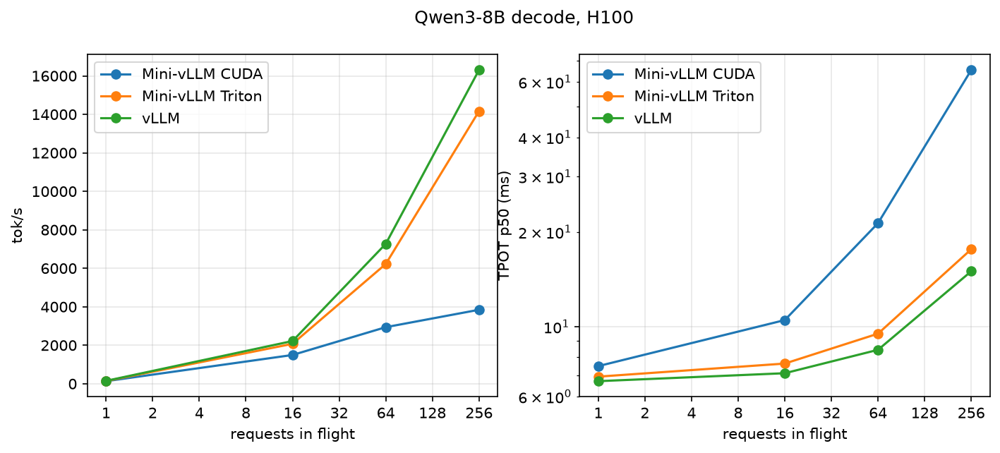

# After the refactor: Qwen3-8B, one H100

Measured at `ceeb2c2` on the same setup as [baseline.md](baseline.md): H100 80GB HBM3, 12,288 KV blocks, ≤256
sequences, greedy. Mini-vLLM now replays decode steps from CUDA graphs; vLLM 0.31.0 as before.
Tests: 45 pass on one H100, tensor-parallel test passes on two.

## Headlines

| tok/s | baseline (CUDA) | Mini-vLLM CUDA | Mini-vLLM Triton | vLLM |
|---|---|---|---|---|
| decode-heavy, 1 in flight | 87 | 133 | 139 | 149 |
| decode-heavy, 16 in flight | 1,304 | 1,494 | 2,074 | 2,219 |
| decode-heavy, 256 in flight | 3,775 | 3,844 | 14,165 | 16,305 |
| prefill-heavy, 8 in flight | 96 | 96 | 169 | 260 |

| profile (ms/step) | step | GPU | attention |
|---|---|---|---|
| CUDA, 16 in flight (baseline 20.3 / 8.9 / 1.9) | 10.7 | 8.7 | 1.8 |
| Triton, 16 in flight | 8.2 | 7.0 | 0.3 |
| CUDA, 256 in flight (baseline 42.4 / 38.1 / 29.1) | 42.1 | 38.1 | 29.1 |
| Triton, 256 in flight | 13.7 | 10.7 | 2.3 |

- CUDA graphs halved the step at 16 in flight (launch-bound → GPU 82% busy).
- Triton's GQA-packed paged kernel reads each K/V tile once per group: attention 29 → 2.3 ms at 256 in flight,
  3.8× the baseline's throughput, 87% of vLLM's.
- The CUDA paged kernel (one block per token and head) is unchanged and still caps CUDA at 3.8k tok/s.
- Prefill-heavy TTFT p99 is still ~1.2 s on both backends (vLLM 0.39 s): long prompts prefill one sequence at
  a time. Next: split-K decode and a batched prefill launch.

## Full tables

From [final.json](final.json); (±%) vs baseline.

### Environment

| engine | GPU | CPU | driver | torch | CUDA | load (s) | KV blocks |
|---|---|---|---|---|---|---|---|
| Mini-vLLM CUDA | NVIDIA H100 80GB HBM3 | 24 cores, Python loop 50.9 ms | 610.57.04 | 2.14.1+cu130 | 13.0 | 7.7 | 12288 |
| Mini-vLLM Triton | NVIDIA H100 80GB HBM3 | 24 cores, Python loop 50.6 ms | 610.57.04 | 2.14.1+cu130 | 13.0 | 7.5 | 12288 |
| vLLM | NVIDIA H100 80GB HBM3 | 24 cores, Python loop 50.5 ms | 610.57.04 | 2.13.0+cu130, vLLM 0.31.0 | 13.0 | 95.3 | 12288 |

### decode-heavy (128 in, 512 out)

**tok/s**

| load | Mini-vLLM CUDA | Mini-vLLM Triton | vLLM |
|---|---|---|---|
| 1 in flight | 133 (+52%) | 139 | 149 (+0%) |
| 16 in flight | 1,494 (+15%) | 2,074 | 2,219 (+1%) |
| 64 in flight | 2,939 (+11%) | 6,223 | 7,271 (+0%) |
| 256 in flight | 3,844 (+2%) | 14,165 | 16,305 (+0%) |

**TTFT p50 (ms)**

| load | Mini-vLLM CUDA | Mini-vLLM Triton | vLLM |
|---|---|---|---|
| 1 in flight | 13.7 (-9%) | 19.4 | 10.6 (-9%) |
| 16 in flight | 123.8 (+5%) | 50.9 | 55.7 (-4%) |
| 64 in flight | 252.1 (-5%) | 99.2 | 184.5 (-4%) |
| 256 in flight | 482.7 (+3%) | 217.3 | 311.8 (+1%) |

**TTFT p99 (ms)**

| load | Mini-vLLM CUDA | Mini-vLLM Triton | vLLM |
|---|---|---|---|
| 1 in flight | 56.1 (+156%) | 474.8 | 11.2 (-9%) |
| 16 in flight | 123.8 (+5%) | 50.9 | 58.5 (-4%) |
| 64 in flight | 494.8 (-1%) | 513.2 | 207.7 (-1%) |
| 256 in flight | 2,099.2 (+2%) | 918.4 | 831.4 (-0%) |

**TPOT p50 (ms)**

| load | Mini-vLLM CUDA | Mini-vLLM Triton | vLLM |
|---|---|---|---|
| 1 in flight | 7.50 (-34%) | 6.94 | 6.71 (-0%) |
| 16 in flight | 10.50 (-13%) | 7.64 | 7.12 (-1%) |
| 64 in flight | 21.34 (-10%) | 9.50 | 8.44 (-0%) |
| 256 in flight | 65.47 (-2%) | 17.63 | 15.01 (-1%) |

**ITL p99 (ms)**

| load | Mini-vLLM CUDA | Mini-vLLM Triton | vLLM |
|---|---|---|---|
| 1 in flight | 7.84 (-32%) | 7.13 | 7.04 (-1%) |
| 16 in flight | 11.91 (-10%) | 7.92 | 7.55 (-1%) |
| 64 in flight | 26.64 (-24%) | 10.05 | 9.50 (-0%) |
| 256 in flight | 241.89 (+2%) | 100.27 | 35.43 (+3%) |

**MBU % (from ITL)**

| load | Mini-vLLM CUDA | Mini-vLLM Triton | vLLM |
|---|---|---|---|
| 1 in flight | 60.5 (+52%) | 65.3 | 67.6 (+0%) |
| 16 in flight | 45.7 (+13%) | 62.7 | 67.4 (+1%) |
| 64 in flight | 26.6 (+11%) | 60.9 | 66.4 (-0%) |
| 256 in flight | 13.9 (+2%) | 53.5 | 62.5 (+1%) |

**MBU % (forward)**

| load | Mini-vLLM CUDA | Mini-vLLM Triton | vLLM |
|---|---|---|---|
| 1 in flight | 62.8 (+52%) | 68.1 | - |
| 16 in flight | 45.2 (+7%) | 62.9 | - |
| 64 in flight | 23.5 (-9%) | 56.1 | - |
| 256 in flight | 10.1 (-31%) | 44.4 | - |

**MBU % (step)**

| load | Mini-vLLM CUDA | Mini-vLLM Triton | vLLM |
|---|---|---|---|
| 1 in flight | 60.4 (+52%) | 65.1 | - |
| 16 in flight | 43.2 (+7%) | 59.3 | - |
| 64 in flight | 22.3 (-8%) | 50.4 | - |
| 256 in flight | 9.6 (-31%) | 36.5 | - |

### prefill-heavy (2048 in, 16 out)

**tok/s**

| load | Mini-vLLM CUDA | Mini-vLLM Triton | vLLM |
|---|---|---|---|
| 8 in flight | 96 (+1%) | 169 | 260 (+0%) |

**TTFT p50 (ms)**

| load | Mini-vLLM CUDA | Mini-vLLM Triton | vLLM |
|---|---|---|---|
| 8 in flight | 278.3 (+1%) | 127.8 | 241.7 (-0%) |

**TTFT p99 (ms)**

| load | Mini-vLLM CUDA | Mini-vLLM Triton | vLLM |
|---|---|---|---|
| 8 in flight | 1,167.1 (+1%) | 1,240.2 | 388.7 (-2%) |

**TPOT p50 (ms)**

| load | Mini-vLLM CUDA | Mini-vLLM Triton | vLLM |
|---|---|---|---|
| 8 in flight | 66.69 (-1%) | 28.94 | 16.36 (-0%) |

**ITL p99 (ms)**

| load | Mini-vLLM CUDA | Mini-vLLM Triton | vLLM |
|---|---|---|---|
| 8 in flight | 278.58 (+1%) | 113.46 | 98.09 (+0%) |

### Profile: Mini-vLLM CUDA, decode-16-in-flight

Step 10.7 ms, GPU 8.7 ms (82% busy), 781 kernels.

| GPU category | ms/step |
|---|---|
| gemm | 5.866 |
| attention | 1.813 |
| norm | 0.299 |
| copy | 0.287 |
| rope | 0.127 |
| kv_write | 0.110 |
| elementwise | 0.108 |
| activation | 0.076 |
| sampling | 0.011 |

| host span | ms/step |
|---|---|
| schedule | 0.079 |
| prepare | 0.285 |
| forward | 1.331 |
| sample | 8.727 |
| spec.verify | 0.011 |
| commit | 0.027 |

| kernel | category | ms/step | calls |
|---|---|---|---|
| `nvjet_sm90_tst_192x16_64x8_2x1_v_bz_TNT` | gemm | 2.642 | 36 |
| `void (anonymous namespace)::paged_attention_kernel<c10::BFloat16, c10::BFloat16>` | attention | 1.813 | 36 |
| `nvjet_sm90_tst_64x16_64x16_2x1_v_bz_splitK_TNT` | gemm | 1.367 | 36 |
| `nvjet_sm90_tst_64x16_64x16_4x1_v_bz_TNT` | gemm | 0.774 | 36 |
| `nvjet_sm90_tst_128x16_64x11_4x1_v_bz_splitK_TNT` | gemm | 0.512 | 36 |
| `nvjet_sm90_tst_384x16_64x4_2x1_v_bz_TNT` | gemm | 0.438 | 1 |
| `void (anonymous namespace)::rms_norm_kernel<c10::BFloat16, mini_vllm::Vector<c10` | norm | 0.299 | 145 |
| `void at::native::elementwise_kernel<128, 4, at::native::gpu_kernel_impl_nocast<a` | copy | 0.251 | 108 |
| `void cublasLt::splitKreduce_kernel<32, 16, int, float, __nv_bfloat16, float, __n` | gemm | 0.132 | 72 |
| `void (anonymous namespace)::rope_kernel<c10::BFloat16>(c10::BFloat16 const*, int` | rope | 0.127 | 72 |

### Profile: Mini-vLLM CUDA, decode-256-in-flight

Step 42.1 ms, GPU 38.1 ms (90% busy), 709 kernels.

| GPU category | ms/step |
|---|---|
| attention | 29.087 |
| gemm | 6.896 |
| norm | 0.544 |
| activation | 0.511 |
| copy | 0.387 |
| rope | 0.231 |
| elementwise | 0.205 |
| kv_write | 0.157 |
| sampling | 0.059 |

| host span | ms/step |
|---|---|
| schedule | 0.855 |
| prepare | 1.108 |
| forward | 1.459 |
| sample | 37.983 |
| spec.verify | 0.022 |
| commit | 0.147 |

| kernel | category | ms/step | calls |
|---|---|---|---|
| `void (anonymous namespace)::paged_attention_kernel<c10::BFloat16, c10::BFloat16>` | attention | 29.087 | 36 |
| `nvjet_sm90_tst_192x128_64x5_1x2_h_bz_coopB_TNT` | gemm | 3.004 | 36 |
| `nvjet_sm90_tst_128x64_64x8_1x2_h_bz_TNT` | gemm | 2.544 | 72 |
| `nvjet_sm90_tst_96x128_64x7_2x1_v_bz_TNN` | gemm | 0.855 | 36 |
| `void (anonymous namespace)::rms_norm_kernel<c10::BFloat16, mini_vllm::Vector<c10` | norm | 0.544 | 145 |
| `void (anonymous namespace)::silu_and_mul_kernel<c10::BFloat16>(c10::BFloat16 con` | activation | 0.511 | 36 |
| `nvjet_sm90_tst_256x128_64x4_1x2_h_bz_coopA_TNT` | gemm | 0.493 | 1 |
| `void at::native::elementwise_kernel<128, 4, at::native::gpu_kernel_impl_nocast<a` | copy | 0.307 | 108 |
| `void (anonymous namespace)::rope_kernel<c10::BFloat16>(c10::BFloat16 const*, int` | rope | 0.231 | 72 |
| `void at::native::vectorized_elementwise_kernel<8, at::native::CUDAFunctor_add<c1` | elementwise | 0.205 | 72 |

### Profile: Mini-vLLM CUDA, mixed

Step 23.0 ms, GPU 19.1 ms (83% busy), 890 kernels.

| GPU category | ms/step |
|---|---|
| attention | 9.459 |
| gemm | 7.456 |
| copy | 0.716 |
| norm | 0.515 |
| activation | 0.405 |
| rope | 0.222 |
| elementwise | 0.179 |
| kv_write | 0.161 |
| sampling | 0.011 |

| host span | ms/step |
|---|---|
| schedule | 0.092 |
| prepare | 0.456 |
| forward | 10.329 |
| sample | 11.823 |
| spec.verify | 0.013 |
| commit | 0.069 |

| kernel | category | ms/step | calls |
|---|---|---|---|
| `(anonymous namespace)::flash_prefill_kernel(__nv_bfloat16 const*, __nv_bfloat16 ` | attention | 4.785 | 14.4 |
| `void (anonymous namespace)::paged_attention_kernel<c10::BFloat16, c10::BFloat16>` | attention | 4.675 | 36 |
| `nvjet_sm90_tst_192x16_64x8_2x1_v_bz_TNT` | gemm | 1.585 | 21.6 |
| `nvjet_sm90_tst_64x16_64x16_2x1_v_bz_splitK_TNT` | gemm | 0.823 | 21.6 |
| `nvjet_sm90_tst_192x176_64x4_1x2_h_bz_coopB_TNT` | gemm | 0.818 | 7.2 |
| `void at::native::elementwise_kernel<128, 4, at::native::gpu_kernel_impl_nocast<a` | copy | 0.565 | 165.6 |
| `nvjet_sm90_tst_192x192_64x4_2x1_v_bz_coopB_TNN` | gemm | 0.543 | 3.6 |
| `void (anonymous namespace)::rms_norm_kernel<c10::BFloat16, mini_vllm::Vector<c10` | norm | 0.515 | 145 |
| `nvjet_sm90_tst_64x16_64x16_4x1_v_bz_TNT` | gemm | 0.466 | 21.6 |
| `nvjet_sm90_tst_384x16_64x4_2x1_v_bz_TNT` | gemm | 0.439 | 1 |

### Profile: Mini-vLLM Triton, decode-16-in-flight

Step 8.2 ms, GPU 7.0 ms (84% busy), 637 kernels.

| GPU category | ms/step |
|---|---|
| gemm | 5.881 |
| attention | 0.314 |
| norm | 0.293 |
| copy | 0.211 |
| rope | 0.117 |
| activation | 0.067 |
| kv_write | 0.055 |
| sampling | 0.011 |

| host span | ms/step |
|---|---|
| schedule | 0.060 |
| prepare | 0.248 |
| forward | 0.855 |
| sample | 6.929 |
| spec.verify | 0.010 |
| commit | 0.018 |

| kernel | category | ms/step | calls |
|---|---|---|---|
| `nvjet_sm90_tst_192x16_64x8_2x1_v_bz_TNT` | gemm | 2.646 | 36 |
| `nvjet_sm90_tst_64x16_64x16_2x1_v_bz_splitK_TNT` | gemm | 1.372 | 36 |
| `nvjet_sm90_tst_64x16_64x16_4x1_v_bz_TNT` | gemm | 0.775 | 36 |
| `nvjet_sm90_tst_128x16_64x11_4x1_v_bz_splitK_TNT` | gemm | 0.513 | 36 |
| `nvjet_sm90_tst_384x16_64x4_2x1_v_bz_TNT` | gemm | 0.441 | 1 |
| `paged_attention_kernel` | attention | 0.314 | 36 |
| `rms_norm_kernel` | norm | 0.293 | 145 |
| `void at::native::elementwise_kernel<128, 4, at::native::gpu_kernel_impl_nocast<a` | copy | 0.174 | 72 |
| `void cublasLt::splitKreduce_kernel<32, 16, int, float, __nv_bfloat16, float, __n` | gemm | 0.135 | 72 |
| `rope_kernel` | rope | 0.117 | 72 |

### Profile: Mini-vLLM Triton, decode-256-in-flight

Step 13.7 ms, GPU 10.7 ms (78% busy), 565 kernels.

| GPU category | ms/step |
|---|---|
| gemm | 6.935 |
| attention | 2.279 |
| norm | 0.570 |
| rope | 0.307 |
| copy | 0.307 |
| activation | 0.203 |
| kv_write | 0.071 |
| sampling | 0.057 |

| host span | ms/step |
|---|---|
| schedule | 0.806 |
| prepare | 0.940 |
| forward | 0.866 |
| sample | 10.617 |
| spec.verify | 0.017 |
| commit | 0.115 |

| kernel | category | ms/step | calls |
|---|---|---|---|
| `nvjet_sm90_tst_192x128_64x5_1x2_h_bz_coopB_TNT` | gemm | 3.019 | 36 |
| `nvjet_sm90_tst_128x64_64x8_1x2_h_bz_TNT` | gemm | 2.560 | 72 |
| `paged_attention_kernel` | attention | 2.279 | 36 |
| `nvjet_sm90_tst_96x128_64x7_2x1_v_bz_TNN` | gemm | 0.862 | 36 |
| `rms_norm_kernel` | norm | 0.570 | 145 |
| `nvjet_sm90_tst_256x128_64x4_1x2_h_bz_coopA_TNT` | gemm | 0.494 | 1 |
| `rope_kernel` | rope | 0.307 | 72 |
| `void at::native::elementwise_kernel<128, 4, at::native::gpu_kernel_impl_nocast<a` | copy | 0.227 | 72 |
| `silu_and_mul_kernel` | activation | 0.203 | 36 |
| `store_kv_kernel` | kv_write | 0.071 | 36 |

### Profile: Mini-vLLM Triton, mixed

Step 15.3 ms, GPU 10.3 ms (67% busy), 631 kernels.

| GPU category | ms/step |
|---|---|
| gemm | 7.492 |
| attention | 1.452 |
| norm | 0.525 |
| rope | 0.278 |
| copy | 0.263 |
| activation | 0.181 |
| kv_write | 0.066 |
| sampling | 0.012 |

| host span | ms/step |
|---|---|
| schedule | 0.071 |
| prepare | 0.395 |
| forward | 9.783 |
| sample | 4.874 |
| spec.verify | 0.010 |
| commit | 0.047 |

| kernel | category | ms/step | calls |
|---|---|---|---|
| `nvjet_sm90_tst_192x16_64x8_2x1_v_bz_TNT` | gemm | 1.588 | 21.6 |
| `paged_attention_kernel` | attention | 1.452 | 50.4 |
| `nvjet_sm90_tst_192x176_64x4_1x2_h_bz_coopB_TNT` | gemm | 0.830 | 7.2 |
| `nvjet_sm90_tst_64x16_64x16_2x1_v_bz_splitK_TNT` | gemm | 0.826 | 21.6 |
| `nvjet_sm90_tst_192x192_64x4_2x1_v_bz_coopB_TNN` | gemm | 0.550 | 3.6 |
| `rms_norm_kernel` | norm | 0.525 | 145 |
| `nvjet_sm90_tst_64x16_64x16_4x1_v_bz_TNT` | gemm | 0.467 | 21.6 |
| `nvjet_sm90_tst_384x16_64x4_2x1_v_bz_TNT` | gemm | 0.444 | 1 |
| `nvjet_sm90_tst_128x224_64x4_2x1_v_bz_coopA_TNT` | gemm | 0.442 | 3.6 |
| `nvjet_sm90_tst_128x176_64x5_2x1_v_bz_TNT` | gemm | 0.429 | 7.2 |
